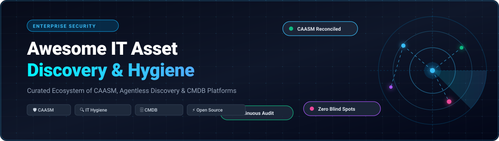

  

# 🛡️ Awesome IT Asset Discovery & Hygiene

  
  
  
  
  
  

> 🌐 A curated list of leading SaaS platforms and open-source tools for **IT Asset Discovery**, **Cyber Asset Attack Surface Management (CAASM)**, **IT Hygiene**, and **Configuration Management Databases (CMDB)**.

Discover every unmanaged device, cloud workload, SaaS app, and identity across your digital footprint. Continuously reconcile multi-source telemetry, eliminate visibility blind spots, verify security agent coverage, and maintain an audit-ready, real-time inventory. 🚀

---

## 📑 Table of Contents

- [📊 Sector Overview & Market Dynamics](#-sector-overview--market-dynamics)
- [☁️ SaaS & Commercial Platforms](#️-saas--commercial-platforms)
- [💻 Open-Source GitHub Projects](#-open-source-github-projects)
- [🏛️ Architectural Comparison: SaaS vs Open Source](#️-architectural-comparison-saas-vs-open-source)
- [🤝 How to Contribute](#-how-to-contribute)
- [💖 Support & Community](#-support--community)
- [📈 Star History](#-star-history)
- [📜 License & Disclaimer](#-license--disclaimer)

---

## 📊 Sector Overview & Market Dynamics

The global dedicated IT asset discovery and automated inventory market is valued at approximately **$2.8B to $3.0B**, expanding at a **CAGR of ~8% to 11%** (within the broader IT Asset Management and Attack Surface Management sector tracking toward **$8.4B+**). 📈

Market dynamics are **moderately fragmented yet increasingly polarized**: enterprise endpoint discovery and real-time query infrastructure are dominated by established platform giants (Microsoft, CrowdStrike, Tanium), while the dedicated Cyber Asset Attack Surface Management (CAASM) and cross-source reconciliation tier is led by category-defining scale-ups (Armis, Axonius) alongside active consolidation by security suites acquiring niche discovery leaders (e.g., Arctic Wolf acquiring Sevco Security, Freshworks acquiring Device42). 🔍

---

## ☁️ SaaS & Commercial Platforms

The table below lists category-leading commercial IT asset discovery and cyber hygiene platforms, sorted in descending order by company scale (market capitalization, valuation, or ARR tier). 🏢

| Platform | Company Valuation / Revenue | Starting Tier Pricing | Free Tier / Trial Limit | Key Focus & Primary Discovery Capability |
| :--- | :--- | :--- | :--- | :--- |
| **[Microsoft Defender Device Inventory](https://learn.microsoft.com/)** | **~$3.1T Market Cap** (Microsoft) | **$3.00 / user / month** (Defender for Endpoint P1; $5.20/user/mo for P2 standalone) | **30-day free trial** (up to 250 evaluation licenses with full EDR & discovery features) | Native device inventory built into Windows/Defender sensor; discovers unmanaged endpoints, IoT/OT, and network devices passively via neighbor probing. |
| **[CrowdStrike Falcon Discover](https://www.crowdstrike.com/)** | **~$78B Market Cap** (CrowdStrike) | **~$28.00 / endpoint / year** (baseline enterprise list add-on or Falcon Enterprise bundle) | **15-day free trial** (Falcon platform trial covering up to 100 endpoints) | IT hygiene module leveraging the lightweight Falcon endpoint sensor to expose unmanaged assets, monitor admin credentials, and track agent deployment coverage. |
| **[Qualys CSAM](https://www.qualys.com/)** | **~$5.5B Market Cap** (Qualys) | **~$10.87 / asset / year** (~$10,870/yr for starter 1,000-asset band via public catalog) | **30-day free trial** (includes full CSAM discovery & External Attack Surface Management for evaluation scopes) | Combines passive network sensors, cloud agents, and External Attack Surface Management (EASM) with two-way ServiceNow CMDB synchronization. |
| **[Tanium Asset](https://www.tanium.com/)** | **~$9B Valuation** (~$700M+ ARR) | **~$20.00 to $24.00 / endpoint / year** (base platform; minimum fleet starter typically 2,000 endpoints) | **No self-service free tier** (30-day guided interactive lab & proof-of-concept trial upon enterprise qualification) | Linear-chain architecture providing instantaneous queries across distributed endpoints within seconds without requiring centralized database pre-indexing. |
| **[Armis](https://www.armis.com/)** | **$6.1B Valuation** (~$340M+ ARR) | **~$3,250 / month** (~$39,000/yr minimum starter tier covering 0–2,500 assets on AWS Marketplace) | **30-day free trial** (guided enterprise trial / exposure assessment proof-of-value) | 100% agentless cyber exposure management powered by the Armis Asset Intelligence Engine; excels at unmanaged IoT, IoMT, OT, and medical device classification. |
| **[Axonius](https://www.axonius.com/)** | **$2.6B Valuation** (~$200M+ ARR) | **~$34,000 / year** (entry-level commercial tier for up to 500–2,500 assets) | **30-day free trial** (cloud-hosted trial connecting up to 10 adapters for correlated asset mapping) | The CAASM industry benchmark; connects via API to 1,000+ infrastructure and security tools to normalize, deduplicate, and build a unified cyber asset graph. |
| **[Lansweeper](https://www.lansweeper.com/)** | **~$920M Valuation** (€800M+ acquisition) | **$239 / month** ($2,868 billed annually, Starter tier covering up to 2,000 assets) | **Free forever plan** for up to **100 assets** (or 14-day unrestricted trial of Pro/Enterprise) | Combines active IP network scanning, agentless discovery, and cross-platform scanning across IT, OT, and cloud environments with hardware lifecycle tracking. |
| **[Device42](https://www.device42.com/)** | **$230M Valuation** (Acquired by Freshworks) | **$1,449 / year** (Core Starter tier for up to 100 devices and 1,000 IP addresses) | **14-day free trial** (unlimited autodiscovery appliances in virtual environments) | Dedicated hybrid cloud CMDB with agentless discovery, automated application dependency mapping (ADM), and data center infrastructure management (DCIM). |
| **[Sevco Security](https://www.sevcosecurity.com/)** | **~$49M Raised** (Acquired by Arctic Wolf) | **Quote-based enterprise contract** (typically ~$18,000–$30,000/yr baseline private offers) | **30-day proof-of-concept trial** (managed enterprise evaluation of multi-source 4D Asset Graph) | Cloud-native asset intelligence with continuous 4D Asset Graph correlation; pinpoints inventory blind spots and security tool telemetry gaps. |
| **[runZero](https://www.runzero.com/)** | **$20M Raised** (Acquired by Dragos) | **$5,000 / year** (commercial platform starter tier for up to 500 managed assets) | **Free forever plan** (Community Edition) for up to **100 assets** (plus 21-day unrestricted trial) | Proprietary scanner by HD Moore providing rapid, safe, unauthenticated network discovery, active fingerprinting, and hardware classification without credentials. |

---

## 💻 Open-Source GitHub Projects

The following open-source solutions provide self-hosted device discovery, endpoint telemetry querying, ITAM, and network CMDB foundations. Repositories are sorted in descending order by GitHub star count. 🌟

| Project | GitHub Stars | Primary Domain / Focus | Key Capabilities & Architecture |
| :--- | :--- | :--- | :--- |
| **[osquery](https://github.com/osquery/osquery)** |  | Endpoint Instrumentation & Telemetry | Exposes the underlying operating system as an interactive relational database. Execute standard SQL queries against running processes, open network sockets, installed packages, browser extensions, and hardware devices across Linux, macOS, and Windows. |
| **[NetBox](https://github.com/netbox-community/netbox)** |  | Network Infrastructure Source of Truth | Leading DCIM and IPAM tool designed specifically for network automation and infrastructure modeling. Acts as the definitive source of truth for IP allocation, physical cabling, rack layouts, virtual machines, and tenant devices. |
| **[Wazuh IT Hygiene](https://github.com/wazuh/wazuh)** |  | Host IT Hygiene & SIEM Integration | Unified IT hygiene and security platform. Provides central dashboard inventory across endpoints: CPU/RAM hardware specs, installed application versions, listening ports, local users, and suspicious browser extensions for fleet-wide audit compliance. |
| **[Snipe-IT](https://github.com/snipe/snipe-it)** |  | IT Asset & License Management (ITAM) | Feature-rich web-based IT asset management system. Tracks physical hardware lifecycles, user assignments, software license entitlements, warranty expirations, barcode/QR labeling, and asset check-in/check-out workflows. |
| **[Nmap](https://github.com/nmap/nmap)** |  | Network Discovery & Port Auditing | The industry-standard network exploration and security scanning tool. Discovers hosts on subnets, probes active raw packet services, identifies remote OS signatures, and inspects network attack surfaces via the Nmap Scripting Engine (NSE). |
| **[NetAlertX](https://github.com/netalertx/NetAlertX)** |  | LAN Discovery & Rogue Device Detection | Wi-Fi and network intelligence scanner. Continuously monitors ARP tables, DHCP leases, UniFi controllers, and Pi-hole databases to instantly detect unknown devices, shadow IT, and IPAM changes across subnets with 80+ notification integrations. |
| **[Fleet](https://github.com/fleetdm/fleet)** |  | Enterprise osquery Manager & MDM | Enterprise-grade device management server that orchestrates osquery at scale. Enables scheduled queries, GitOps-based device posture policies, real-time vulnerability checks, and automated cross-platform MDM controls across laptop and server fleets. |
| **[GLPI](https://github.com/glpi-project/glpi)** |  | Open-Source ITSM & CMDB | Complete ITIL-aligned service management and asset inventory platform. Features automated network discovery, inventory ingestion from GLPI Agent / OCS Inventory, license compliance tracking, and service desk integration. |
| **[iTop](https://github.com/Combodo/iTop)** |  | ITIL Service Management & CMDB | Web-based CMDB and IT service management hub. Models complex dependency graphs between servers, network switches, services, and business processes with complete configuration change tracking. |
| **[Cloudlist](https://github.com/projectdiscovery/cloudlist)** |  | Multi-Cloud Asset Enumeration | Cloud reconnaissance CLI utility designed by ProjectDiscovery. Pulls live asset inventory, public IPs, and DNS records from multiple cloud providers (AWS, Azure, GCP, Cloudflare, DigitalOcean, Fastly, Scaleway) with unified output formatting. |
| **[OCS Inventory NG](https://github.com/OCSInventory-NG/OCSInventory-Server)** |  | Hardware/Software Inventory & CMDB | Self-hosted French inventory solution ensuring full European data sovereignty. Collects hardware configuration, installed software packages, and peripheral details via lightweight cross-platform client agents and network IP discovery. |
| **[TWIGS](https://github.com/threatworx/twigs)** |  | Agentless Attack Surface Discovery | Lightweight Python CLI tool by ThreatWorx for agentless attack surface discovery. Discovers source code repositories, container images, virtual machines, cloud instances, and perimeter network devices without retaining centralized credentials. |

---

## 🏛️ Architectural Comparison: SaaS vs Open Source

| Architectural Capability | Commercial SaaS / CAASM (Axonius, Armis, Sevco, Tanium) | Open-Source Solutions (osquery, NetBox, Wazuh, Snipe-IT) |
| :--- | :--- | :--- |
| **Cross-Source Data Normalization** | **Automated**: Normalizes and deduplicates hostnames, MACs, cloud instance IDs, and IP histories across 1,000+ third-party APIs. | **Manual / Scripted**: Requires custom ETL pipelines, middleware connectors, or manual database imports. |
| **Agentless Device Discovery** | **Continuous**: Combines passive traffic analysis, active network fingerprinting, and API polling across hypervisors and switches. | **Modular**: Requires pairing tools (e.g., Nmap or NetAlertX for LAN sweeps + Cloudlist for cloud infrastructure). |
| **Endpoint Telemetry Fidelity** | **High**: Pre-packaged compliance, vulnerability mapping, and remediation actions. | **Exceptional via osquery / Wazuh**: Offers granular low-level kernel, process, socket, and software query capabilities. |
| **Data Sovereignty & Privacy** | **Vendor-Hosted / Cloud**: Subject to cloud vendor data residency and privacy compliance frameworks. | **100% On-Premises**: Complete infrastructure autonomy; ideal for air-gapped networks, defense, and strict GDPR requirements. |
| **Total Cost of Ownership** | High upfront software license commitments ($5k–$100k+/yr). | $0 license fees; costs correlate to self-hosting infrastructure, maintenance, and engineering integration hours. |

---

## 🤝 How to Contribute

We welcome contributions from IT engineers, security professionals, and open-source maintainers! 🛠️

1. **Fork the repository** on GitHub.
2. **Add or refine an entry** in `README.md`:
   - Keep platform descriptions objective and technically accurate.
   - For SaaS tools: include starting tier pricing, free tier/trial limits, and verified company valuation/market metrics.
   - For open-source tools: include the official GitHub star badge linking to the stargazers directory and specify the architectural role.
3. **Submit a Pull Request** with a brief summary of your proposed changes.

---

## 💖 Support & Community

Thank you for exploring and using this curated resource! If you find this repository helpful, please consider supporting the project:

- ⭐ **Star this repository** to help others discover it!
- 🍴 **Fork and contribute** tools, updates, and architectural notes.
- 📢 **Share with colleagues** across DevOps, SecOps, and ITAM teams.
- ☕ **Sponsor or buy a coffee**: Support ongoing curation and maintenance via the [GitHub Sponsors Dashboard](https://github.com/sponsors/ishandutta2007).

---

## 📈 Star History

---

## 📜 License & Disclaimer

- Licensed under the [MIT License](LICENSE).
- *Disclaimer*: This repository is community-curated for informational and architectural evaluation purposes. Product names, logos, and brands belong to their respective copyright holders. Pricing, free tier allowances, and enterprise valuation metrics are based on publicly available documentation, government procurement records, and vendor filings. Always verify current commercial terms directly with vendor sales channels prior to procurement.
